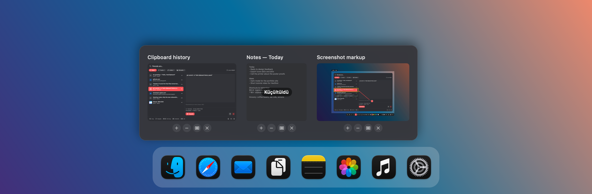
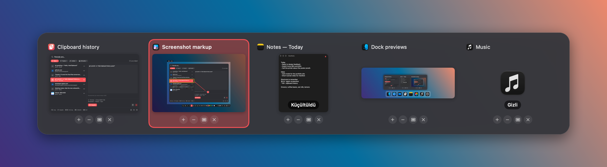

# HexDock

A macOS menu bar app that shows **live window previews** when you hover over Dock icons.



## Features
- Live window thumbnails above Dock icons; click to switch to a window
- Shows minimized windows too; close, minimize, fill or full-screen right from the preview
- **Window switcher** opened with a shortcut (custom shortcut supported)
- **Now playing** card with playback controls for Spotify and Music
- Appearance options such as distance from the Dock and zoom button

**Window switcher:**



## Download
**[⬇ Download HexDock.dmg](https://github.com/Huseyinkayaw/HexDock/raw/main/release/HexDock.dmg)** — open it and drag **HexDock** into **Applications**.

Requires macOS 26+ on Apple Silicon (M1 or later). The app is not notarized by Apple, so the first time you open it macOS will warn you: right-click the app → **Open** → **Open**, or go to **System Settings → Privacy & Security → Open Anyway**.

## Build from source
Requirements: macOS 26+, Xcode Command Line Tools.

```bash
./build.sh   # build and install as /Applications/HexDock.app
```
Needs **Accessibility** and **Screen Recording** permissions (menu bar icon → Permissions).

---

## Türkçe

Dock ikonlarının üzerine gelince o uygulamanın **canlı pencere önizlemelerini** gösteren macOS menü çubuğu uygulaması.

**Özellikler**
- Dock ikonu üzerinde canlı pencere küçük resimleri; tıklayarak pencereye geçiş
- Küçültülmüş pencereleri de gösterir; önizlemeden kapatma, küçültme, doldurma, tam ekran
- Kısayolla açılan **pencere değiştirici** (özel kısayol atanabilir) — görüntüsü yukarıda
- Spotify ve Müzik için **şu an çalan** kartı ve oynatma kontrolleri
- Dock'a mesafe, büyütme düğmesi gibi görünüm ayarları

**İndir:** **[⬇ HexDock.dmg](https://github.com/Huseyinkayaw/HexDock/raw/main/release/HexDock.dmg)** — açın ve **HexDock**'i **Uygulamalar** klasörüne sürükleyin. macOS 26+ ve Apple Silicon (M1 veya üstü) gerekir. Uygulama Apple tarafından onaylanmadığı (notarize edilmediği) için ilk açılışta uyarı çıkar: uygulamaya sağ tıklayın → **Aç** → **Aç**, ya da **Sistem Ayarları → Gizlilik ve Güvenlik → Yine de Aç**.

**Kaynaktan derleme:** macOS 26+ ve Xcode Command Line Tools gerekir. `./build.sh` derler ve `/Applications/HexDock.app` olarak kurar. **Erişilebilirlik** ve **Ekran Kaydı** izinleri gerekir (menü çubuğu simgesi → İzinler).
